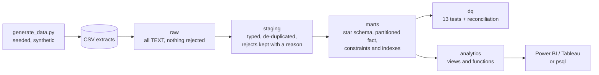
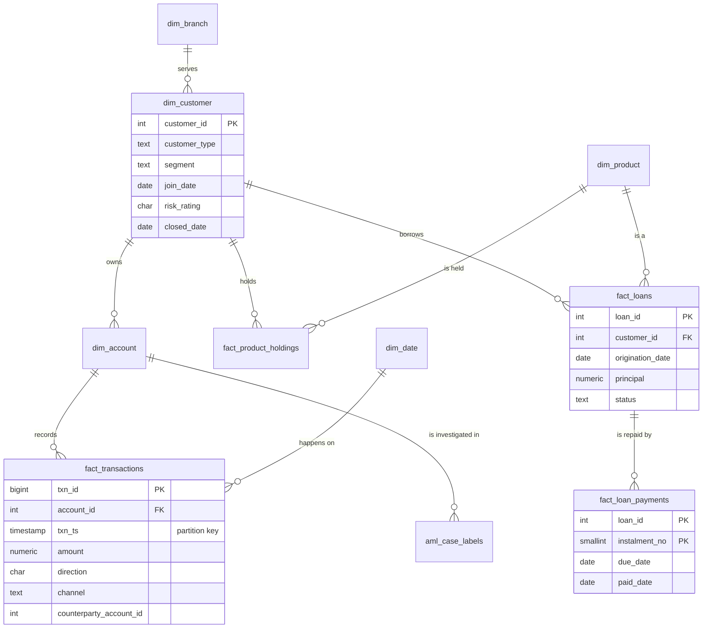

# Retail Banking Analytics in SQL

**English** · [Português](README_PT.md)

An end-to-end analytics project written almost entirely in **PostgreSQL**: from raw CSV extracts of a retail bank to a
tested star schema and four sets of analyses that answer real banking questions about **customers, credit risk and
money laundering**.

The bank ("Liffey Bank") and all of its data are fictional. A seeded Python script generates 20,000 customers,
1.4 million transactions and 5,900 loans, and deliberately hides in them the behaviour the SQL has to find and the
data-quality problems it has to fix.

## What the project answers

| Module | Business question | Advanced SQL used |
|---|---|---|
| [01 Schema](sql/01_schema) | How should the bank's data be modelled? | Star schema, constraints, monthly range partitioning created with dynamic SQL |
| [02 Staging](sql/02_staging) | How do dirty extracts become trusted tables? | `ROW_NUMBER` de-duplication, typed casts, reject table with reasons, materialized view |
| [03 Data quality](sql/03_data_quality) | Can the numbers be trusted? | 13 automated tests, row-level load reconciliation, pipeline stops on failure |
| [04 Customers](sql/04_customer_analytics) | Who is valuable, who is leaving, what should we offer next? | Cohorts, `NTILE` RFM, gaps-and-islands, parameterised SQL function with back-test, market-basket self-join |
| [05 Credit portfolio](sql/05_credit_portfolio) | Which loans are going bad, and how fast? | `LATERAL` month-end snapshots, vintage curves, roll-rate matrix with `LEAD`, `ROLLUP`, moving averages |
| [06 AML detection](sql/06_aml_detection) | Which transactions look like money laundering? | Sessionisation, `RANGE` time windows, recursive CTE over a transfer graph, precision/recall scorecard |
| [07 Performance](sql/07_performance) | Do the design choices pay off? | `EXPLAIN ANALYZE` before and after: composite index, partition pruning, materialized view |

## Key findings

Full write-up with every table: [docs/findings.md](docs/findings.md).

1. **A simple activity rule spots leavers early.** Customers whose activity fell by 60% or more were **4.9 times more
   likely** to close their relationship in the following six months (14.7% against 2.1% for everyone else). The rule
   flags 7% of customers and captures 34% of all leavers.
2. **Half of the spend comes from one fifth of the customers.** The RFM "Champions" are 20% of customers and 49% of card
   and payment volume. A further 1,803 high-value customers are drifting away and account for 13% of volume.
3. **Two cross-sell pairs stand out.** Mortgage holders have home insurance 61% of the time (lift 4.8), and pension and
   investment-fund holders overlap 5.6 times more than chance. That gives 3,244 customers a specific next product.
4. **The 2023 loan vintage is the weak one.** 11.7% of loans granted in 2023 reached 90+ days past due within 24
   months, against 7.3% for 2021 and 8.6% for 2022. Once a loan is 61-90 days late, 57% roll to 90+ the next month.
5. **AML rules trade recall for workload.** The three rules find 84-85% of the confirmed cases with 90-100% precision.
   Lowering the structuring band from EUR 8,000 to EUR 7,000 lifts recall to 95% for four extra false alarms; lowering
   it to EUR 6,000 multiplies false alarms by sixteen.
6. **The physical design matters.** On 1.4 million rows, the composite index cuts an account-history query from about
   30 ms to 0.1 ms, partition pruning reads 747 pages instead of 16,932, and the monthly-activity materialized view is
   over 20 times faster than aggregating the fact table.

## Architecture



## Data model (marts)



`fact_transactions` is range-partitioned by month (24 partitions). `marts.customer_monthly_activity` is a materialized
view that pre-aggregates it per customer and month.

## How to run

Requirements: Docker and Python 3.10+.

```bash
# 1. Generate the data (about 10 seconds, 90 MB of CSV in data/raw)
pip install -r requirements.txt
python data_generation/generate_data.py

# 2. Start PostgreSQL 16
docker compose up -d

# 3. Build everything and print the results (about 1 minute)
docker compose exec db psql -U bank -d retail_bank -f sql/run_all.sql

# 4. Optional: the performance experiments
docker compose exec db psql -U bank -d retail_bank -f sql/07_performance/01_query_tuning.sql
```

Without Docker, create a database on any PostgreSQL 14+ server and run, from the project root:

```bash
psql -d retail_bank -f sql/run_all.sql
```

`sql/run_all.sql` is re-runnable: it drops and rebuilds every schema. Use `--scale 0.25` in step 1 for a quicker,
smaller dataset. To explore the results in Power BI or Tableau, connect to `localhost:5434` (database `retail_bank`,
user and password `bank`) and load the views of the `analytics` schema.

The expected output of step 3 is in [docs/sample_output.txt](docs/sample_output.txt).

## Tableau dashboard

You can access the Tableau visualization through the [link](https://public.tableau.com:9443/views/RetailBankingAnalyticsinSQL/Painel1?:language=pt-BR&:sid=&:redirect=auth&:display_count=n&:origin=viz_share_link).

Tableau Public reads files, not databases, so [sql/09_export_for_tableau.sql](sql/09_export_for_tableau.sql) exports
the results as 14 tidy CSV files into [tableau/data](tableau/data). The files are committed, so the dashboard can be
rebuilt without running the database. To regenerate them:

```bash
docker compose exec db psql -U bank -d retail_bank -f sql/09_export_for_tableau.sql
```

## Repository structure

```
retail_banking_sql/
├── data_generation/generate_data.py   synthetic data, seeded
├── data/raw/                          generated CSVs (not committed)
├── sql/
│   ├── run_all.sql                    builds everything, in order
│   ├── 01_schema/                     raw tables, CSV load, star-schema DDL
│   ├── 02_staging/                    cleaning views, mart load, indexes
│   ├── 03_data_quality/               reconciliation and tests
│   ├── 04_customer_analytics/         cohorts, RFM, churn, cross-sell
│   ├── 05_credit_portfolio/           snapshots, vintages, roll rates, portfolio
│   ├── 06_aml_detection/              structuring, velocity, circular flows, scorecard, tuning
│   ├── 07_performance/                EXPLAIN ANALYZE experiments, refresh
│   ├── 08_headline_results.sql        prints the main result of each module
│   └── 09_export_for_tableau.sql      exports the results as CSV for Tableau Public
├── tableau/data/                      exported results (committed)
├── docs/findings.md                   results and interpretation
├── docs/sample_output.txt             full output of a run
└── docker-compose.yml
```

## Limitations

- **The data is synthetic.** The patterns were planted by the generator, so the findings show that the SQL recovers
  them correctly; they say nothing about any real bank. Real data is noisier, and the AML precision in particular would
  be far lower in practice.
- **The AML "confirmed cases" are simulated labels.** They come from the generator, not from investigators. About 15%
  of the planted cases were made deliberately harder so that the rules do not score 100%.
- **Rules, not models.** Churn and AML detection use transparent thresholds. They are a baseline that a statistical
  model would normally be compared against.
- **Timings are from one machine** (PostgreSQL 16, 2 CPU cores) and will differ elsewhere. The change in query plan is
  the point, not the milliseconds.
- **Tested on PostgreSQL 16.** The SQL uses PostgreSQL features (declarative partitioning, `FILTER`, `RANGE` frames
  with intervals, `LATERAL`) and would need changes for other databases.

## Author

Lúcio Júnio Benfica Rosa · [Portfolio](https://benfluc.github.io/) · [GitHub](https://github.com/Benfluc)
